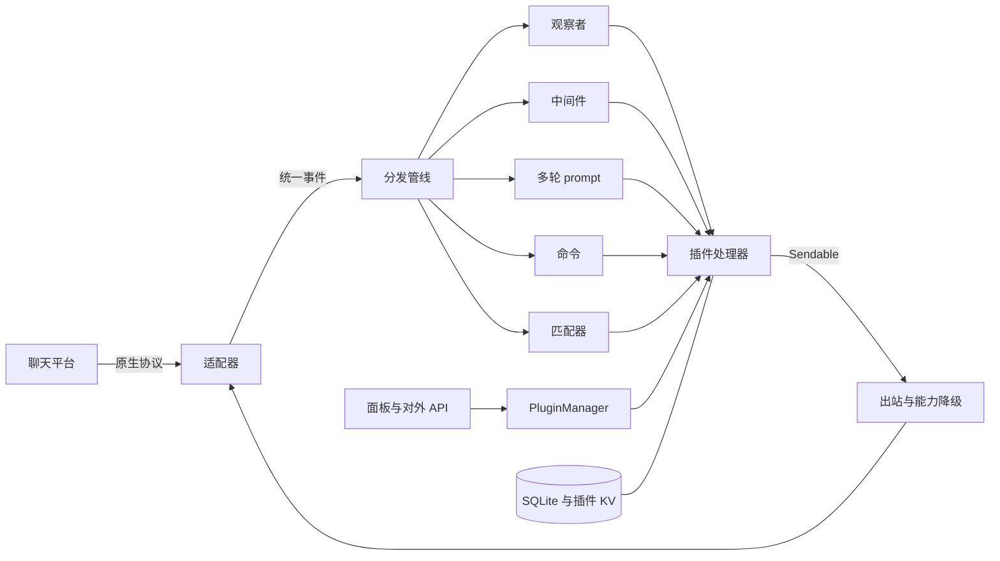

# AsaBot 开发指南

面向 AI 编码助手和贡献者的操作指南。它回答「要改这个，该看什么、该怎么做、哪些不能碰」，不重复 DESIGN.md 的设计论证，也不重复 README 的用户教程。

## 文档关系

| 文档 | 用途 | 什么时候读 |
| --- | --- | --- |
| `src/` 的 TypeScript 类型与测试 | 运行时的事实来源 | 任何签名、行为不确定时 |
| [DESIGN.md](../DESIGN.md) | 权威设计与约束 | 实现新功能、修改协议、状态或数据结构前 |
| `docs/guide/`（本目录） | 做法、规范、检查清单 | 每次动手前 |
| [README.md](../../README.md) | 面向使用者的教程与 API 速查 | 写插件、查 API 细节 |
| [CLAUDE.md](../../CLAUDE.md) | 仓库级硬性约束摘要 | 进入仓库时 |

冲突处理：代码与 DESIGN 不一致时，不要静默按代码实现；在交付说明里指出，由维护者决定。纯事实性出入（例如文档里的旧包名、过时链接）直接修正文档。

## 先建立心智模型

AsaBot 是协议无关的聊天机器人框架。核心层只认识统一事件、统一消息段和统一的 Bot 接口；每个平台一个适配器。插件运行在主进程内，通过 `Context` 注册命令、事件处理器、定时任务、服务和面板页面，卸载时自动回收。

关键事实：

- 所有平台 ID 都是字符串，数字转换只发生在适配器内。
- 消息内容统一为 `Segment[]`；字符串始终按纯文本发送。
- 发送时框架按机器人能力自动降级不支持的段，例如按钮变成「文本：命令」。
- 插件是受信任的进程内代码，没有沙箱；只有面板里的插件页是沙箱 iframe。
- 插件注册的资源随插件卸载回收；耗时操作要响应 `ctx.signal`。
- 机器人、连接和插件开关是三个维度：连接负责协议，机器人是账号，插件还要在对应机器人上启用。

## 按任务找文档

| 你要做的事 | 必读 | 参考 |
| --- | --- | --- |
| 写一个业务插件 | [plugin.md](plugin.md) | README「开发插件」、DESIGN 12 |
| 给插件加面板页 | [plugin.md](plugin.md)、[ui.md](ui.md) | DESIGN 24.9、`packages/panel-ui/README.md` |
| 改控制台页面 | [ui.md](ui.md)、[motion.md](motion.md) | `web/src/pages/` 现有页面 |
| 加或改动效 | [motion.md](motion.md) | `packages/panel-ui/src/motion.ts` |
| 改核心、分发、命令、权限 | [code.md](code.md) | DESIGN 5–16 |
| 新增适配器 | [code.md](code.md) | DESIGN 7–8、`src/core/adapter.ts` |
| 写测试 | [code.md](code.md#测试) | `src/testing/`、`test/` |
| 发布插件包 | [plugin.md](plugin.md#发布) | DESIGN 24.12 |

## 全局硬规则

来自 `CLAUDE.md`，每次都要遵守：

- Node ≥ 24，仓库内直接运行 `.ts`。禁止 `enum`、`namespace`、构造函数参数属性、`import = require`。
- 相对导入带 `.ts` 后缀；纯类型导入用 `import type`。
- 插件从 `@asabot/core` 导入框架；zod 也只从这个入口导入。
- `src/core/**` 不得导入 `src/adapters/**`、`src/plugins/**`、`src/server/**`。
- 依赖只能通过 `pnpm add` 管理，不手改 lockfile。
- 不吞异常；插件和处理函数的异常要带插件名和事件上下文记录日志。
- 日志和错误信息中不出现 token、密码或带 `access_token` 的 URL。
- 行尾统一 LF。
- 每个功能切片验证通过后提交一次，只暂存本切片的文件；不推送远端。
- 不创建 `STATUS.md`、`DEVLOG.md` 之类的进度文档；未完成项用代码里的 `TODO:` / `FIXME:`，设计层面的已知限制写进 DESIGN.md。

## 下一步

- 新插件：从 [plugin.md](plugin.md#最小骨架) 开始。
- 面板页：先读 [ui.md](ui.md#页面骨架)，再读 [motion.md](motion.md#场景与预设)。
- 核心改动：先在 DESIGN.md 找到对应章节，再读 [code.md](code.md)。
