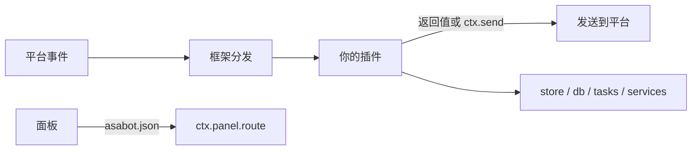

# AsaBot 插件开发指南

面向插件作者：从第一个能跑的插件，到带面板页、测试和发布。示例只使用 `@asabot/core`、`@asabot/core/testing` 和 `@asabot/panel-ui` 的公开 API。需要 Node.js 24 或更高版本。

如果你要改框架本身（核心、适配器、控制台），看 [DESIGN.md](../DESIGN.md)；贡献流程和仓库规范在 [CLAUDE.md](../../CLAUDE.md)。

## 阅读路线

| 你要做的事 | 读 |
| --- | --- |
| 写出第一个插件 | [plugin.md](plugin.md#最小骨架) |
| 加命令、事件、多轮对话 | [plugin.md](plugin.md#常用配方) |
| 存数据 | [plugin.md](plugin.md#kv-与迁移) |
| 定时任务和持久任务 | [plugin.md](plugin.md#定时与持久任务) |
| 提供服务或使用别人的服务 | [plugin.md](plugin.md#服务) |
| 给插件加面板页 | [panel-ui.md](panel-ui.md) |
| 面板页的动效 | [motion.md](motion.md) |
| 测试、打包、发布 | [package.md](package.md) |
| 查完整 API 和逐项说明 | [README「开发插件」](../../README.md#开发插件) |

## 插件与框架的边界



- 插件是运行在 AsaBot 主进程内的 ESM 模块，入口默认导出 `definePlugin(...)`。
- 框架负责协议、分发、权限、冷却、发送与能力降级；插件只处理业务。
- 插件注册的资源（命令、监听器、定时器、路由、面板页）随插件卸载自动回收。
- 插件与宿主同权限运行，没有沙箱；面板页是插件唯一的沙箱环境。
- 文件插件默认放在 `plugins/`（`pluginLoader.dirs` 的默认值），可以在面板上传 `.ts`、`.js` 或包含 `index.ts` / `index.js` 的 zip；开发时热重载。
- npm 包从面板或 `/plugin install <包名>` 安装。
- 插件可以按机器人、按群启停；服务、定时器和持久任务是全局资源。

## 最小示例

```ts
import { definePlugin } from '@asabot/core'

export default definePlugin({
  name: 'hello',
  setup(ctx) {
    ctx.command('hello [name=朋友]')
      .description('打个招呼')
      .action(({ args }) => `你好，${args.name}！`)
  },
})
```

保存为 `plugins/hello.ts`，启动后发送 `/hello 小明`。

## 从示例开始

- `plugins/echo.ts`：配置 schema、命令选项、冷却、成员加入事件。
- `plugins/guess.ts`：多轮对话、`store` 读写、子命令。
- `packages/create/templates/plugin/`：可发布 npm 包的完整结构。

## 插件作者需要遵守的规则

- 名称：`/^[a-z0-9][a-z0-9_-]*$/`，全局唯一，`core` 保留。
- 只从 `@asabot/core` 导入框架和 zod；平台专属能力从 `@asabot/core/onebot11` 等子路径导入，并用类型守卫判断。
- 不吞异常。框架会记录命令、事件和定时任务的异常；自己管理的异步流程要 catch，并用 `ctx.logger` 记录上下文；耗时操作响应 `ctx.signal`。
- 日志和错误信息不出现 token、密码或带 `access_token` 的 URL。
- 面板页静态文件公开，不放敏感数据；数据通过 `ctx.panel.route` 提供。
- npm 包把 `@asabot/core` 声明为 `peerDependencies`，不要打进产物。

## 文档关系

| 文档 | 用途 |
| --- | --- |
| 本目录 | 插件作者的操作指南与规范 |
| [README「开发插件」](../../README.md#开发插件) | 完整 API、配置和命令语法 |
| [DESIGN.md](../DESIGN.md) | 框架设计背景；查行为原因时读 |
| [panel-ui README](../../packages/panel-ui/README.md) | 组件包用法和可运行示例 |
